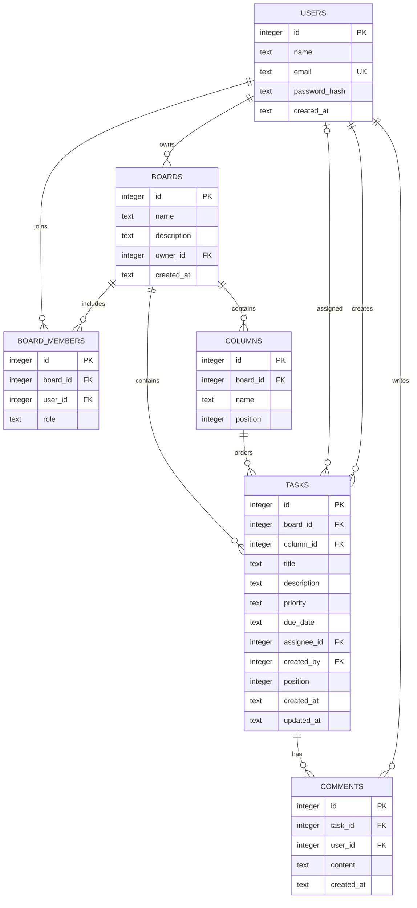

# Entity relationship diagram

board_members has a unique (board_id, user_id) pair. An owner is also inserted as an owner member when creating a board. Tasks may be unassigned. Foreign-key deletes cascade from boards through columns/tasks/comments and board membership; deleting an assignee user sets the assignment to NULL. The API enforces that a task's column and assignee belong to the same board. Removing membership clears that board's assignments for the removed user.
